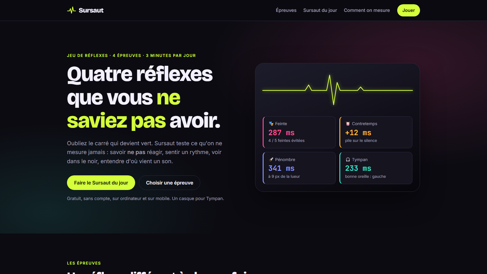

# Sursaut · Quatre réflexes que vous ne saviez pas avoir

> Jour 06 du défi **30 jours, 30 projets** · HTML, CSS et JavaScript, Web Audio · 🟢 **En ligne : [sursaut.projectp.fr](https://sursaut.projectp.fr)**



Les jeux de réflexes se ressemblent tous : un carré devient vert, on clique, on lit son temps. **Sursaut** mesure quatre réflexes qu'on ne teste presque jamais : savoir **ne pas** réagir, sentir un rythme, voir dans le noir, entendre d'où vient un son.

📄 Les règles détaillées sont dans le [cahier des charges](CAHIER_DES_CHARGES.md).

## Pages

| Page | Contenu |
| --- | --- |
| `index.html` | Vitrine : les quatre épreuves et vos records, le Sursaut du jour, votre profil, la façon de mesurer |
| `jouer.html#feinte` (ou `#contretemps`, `#penombre`, `#tympan`) | Une épreuve en jeu libre (20 essais, 4 phases) : règle, partie, résultat, record |
| `jour.html` | Le Sursaut du jour : les quatre épreuves enchaînées, le profil et le partage |

## Les quatre épreuves

| Épreuve | Réflexe | Le principe | Phases |
| --- | --- | --- | --- |
| 🎭 **Feinte** | l'inhibition | Une consigne (« touche quand c'est rouge »), puis des signaux : vite sur le vrai, immobile devant les leurres. | Couleur · Mot (effet Stroop) · Son (un bip de départ, juste avant le signal, qui ment) · Volte-face (la consigne s'inverse et se rétablit sans prévenir) |
| 🥁 **Contretemps** | le rythme | Une boucle rythmique joue, un temps manque : taper exactement là où il aurait dû tomber. L'écart s'affiche en ms. | Régulier (un tempo différent à chaque boucle) · Accelerando (le tempo monte pendant la boucle) · Boiteux (3 et 5 temps) · Syncopé |
| 🔦 **Pénombre** | l'œil | Une lueur s'allume une fraction de seconde dans le noir : cliquer là où elle était, vite et près. | Franche · Furtive · Pâle · Mirage (deux lueurs, une seule est la bonne) |
| 🎧 **Tympan** | l'oreille | Au casque, sans rien voir : un son part à gauche ou à droite, choisir le bon côté. | Net · Proche (vers le centre) · Écho (le premier son a raison) · Croisé (le son se déplace) |

Chaque partie donne une **note sur 100** et son mot (de « En hibernation » à « Fulgurant »), avec le détail : temps moyen et meilleur temps, écart, feintes évitées, faux départs.

| Épreuve | Comment la note est calculée |
| --- | --- |
| Feinte | 60 % vitesse sur les vrais signaux (pleine note jusqu'à 250 ms, nulle à 900 ms) · 40 % feintes évitées |
| Contretemps | Pleine note sous 15 ms d'écart, nulle à 200 ms, moyenne des silences |
| Pénombre | 60 % précision (pleine sous 4 % de l'écran, nulle à 25 %) · 40 % vitesse (pleine à 300 ms, nulle à 1 s) |
| Tympan | 50 % bonnes réponses · 50 % vitesse des bonnes réponses (pleine à 250 ms, nulle à 1 s) |

Un **faux départ** (appui avant le signal, ou moins de 100 ms après : plus vite que l'œil) coûte 5 points.

## ⚡ Le Sursaut du jour

Les quatre épreuves en version courte (8 essais, phases 1 à 3), environ trois minutes, avec **les mêmes tirages pour tout le monde** ce jour-là : délais, consignes, rythmes, positions et côtés sortent d'un générateur pseudo-aléatoire initialisé avec la date (heure de Paris). Seule la première tentative est gardée ; on peut ensuite s'entraîner sur le même tirage.

À la fin : la note globale, le **profil de réflexes** sur quatre axes, un **titre** (« Le métronome », « Le guetteur », « La chauve-souris », « L'équilibriste », « Le chat »…), la série de jours consécutifs et un texte à partager, sans donnée personnelle :

```
Sursaut · 19 oct. · 77/100
🎭 82  🥁 64  🔦 71  🎧 90
« Le guetteur » · sursaut.projectp.fr/
```

## Comment le temps est mesuré

Un jeu de réflexes ne vaut que par la justesse de ses mesures :

- les appuis sont lus dès l'enfoncement (`pointerdown`, `keydown`) avec `event.timeStamp`, pas au relâchement ;
- un signal visuel compte à partir de **l'image qui l'affiche vraiment** (`requestAnimationFrame`), pas du moment où le code l'a demandé ;
- les sons sont programmés sur **l'horloge audio** (`AudioContext.currentTime`), la seule assez stable pour un rythme à la milliseconde, puis convertis sur l'horloge des appuis ;
- Contretemps se **calibre** une fois par appareil (taper huit temps en rythme) pour corriger la latence du son et de l'écran ; Tympan commence par un **test du casque** (gauche et droite dans le bon sens).

Vérifié avec un pilote automatique qui répond à heure fixe : 300 ms demandées, 316 ms mesurées dans Feinte (une image d'écran), 400 ms demandées, 411 ms mesurées dans Tympan.

## Sans compte, sans serveur

- Records, historique, Sursauts joués, calibration et test du casque restent sur l'appareil (`localStorage`). Sans stockage (navigation privée), on joue, sans records.
- Tous les sons sont générés en direct par Web Audio : aucun fichier audio, aucune requête vers un autre site que les polices.
- Si la page passe en arrière-plan pendant une partie, l'essai en cours est annulé puis rejoué à l'identique.
- Pénombre : jamais de flash plein écran, au plus une lueur par seconde, lueurs douces ; un avertissement s'affiche avant de jouer.
- Mouvements réduits si le système le demande (`prefers-reduced-motion`).

## Lancer en local

Le site est fait de modules JavaScript : il faut le servir, il ne s'ouvre pas directement depuis le fichier.

```bash
npx serve .              # ou : python -m http.server
node --test              # tests unitaires : tirages, règles des épreuves, notes
```

## Structure

```
index.html, jouer.html, jour.html
css/style.css              Identité et mise en page
js/
├── app.js                 Accueil : records, Sursaut du jour, profil
├── play.js                Jeu libre
├── daily.js               Sursaut du jour, profil, partage
├── core/                  Horloges, tirages reproductibles, appuis, sons, notes, stockage, boucle des essais
├── games/                 Les quatre épreuves (même interface : plan, run, score, stats)
└── ui/                    Scène de jeu, résultat, profil en radar, lancement
tests/                     node --test, sans dépendance
docs/preview.png           Capture de l'accueil, affichée dans ce README
```

## Stack

HTML, CSS et JavaScript en modules, sans framework ni dépendance · Web Audio · SVG · Hébergement Coolify (site statique).
